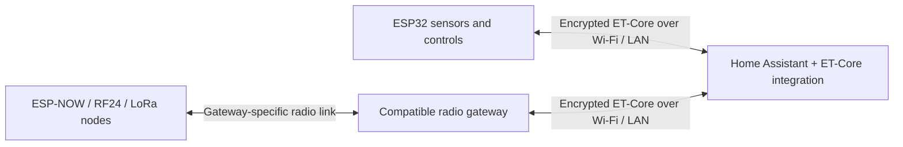

<p align="center">
  <picture>
    <source media="(prefers-color-scheme: dark)" srcset="docs/img/electronicstech-logo-dark.png">
    
  </picture>
</p>

# ET-Core

**Local ESP32 control and telemetry for Home Assistant, with encrypted UDP communication.**

ET-Core connects your own ESP32 firmware to Home Assistant without an MQTT broker or cloud service. Devices announce themselves, report their state and send small lease messages so Home Assistant can detect when they disappear. Commands have acknowledgements, retries and duplicate-command protection.

The repository includes the Arduino SDK, Home Assistant integration, sidebar dashboard, firmware examples and protocol specification.

[Get started](#get-started) · [Downloads](https://github.com/mantiz010/ET-Core/releases/latest) · [Network map](docs/gateway-network-map.md) · [Protocol](spec/protocol-v1.md) · [Test results](#tested-scale)

> **Version:** the Arduino SDK and HA integration on `main` identify as **0.4.6**. Recent examples and dashboard improvements on `main` may be newer than the latest release bundle. Use the matching source files when installing those additions.

## What you get

| Feature | What it does |
| --- | --- |
| Local communication | ESP32 devices communicate directly with the HA integration over your LAN. |
| Encrypted mode | ChaCha20-Poly1305 payloads, derived device keys, session nonces and replay checks. |
| Lease-based availability | Devices check in at a configured interval; expired leases make them unavailable in HA. |
| Acknowledged commands | Timeouts, bounded retries and duplicate-command handling are built into the transport. |
| Native HA entities | Switches, lights, fans, numbers, sensors and binary sensors, according to the device profile. |
| Sidebar dashboard | Device controls, signal, uptime, command timing, live messages and health diagnostics. |
| Gateway node views | Recognised ESP-NOW and RF24 profiles show grouped radio nodes, readings, report ages and HA controls. |
| Existing-firmware migrations | Hardware-specific examples demonstrate retaining local controls, calibration, Telnet and Arduino OTA. |

A command acknowledgement confirms the receiving firmware's handling of that command. It does **not** automatically prove that a remote relay, pump or radio node physically changed state.

## How it fits together



The encrypted ET-Core link runs between the ESP32 and Home Assistant. Downstream radio protocols and physical routing belong to the gateway firmware. ET-Core does not turn radio nodes into individual Wi-Fi clients.

Direct Wi-Fi devices are best suited to powered installations. Sleeping battery nodes need a gateway or a design that explicitly handles their reporting intervals. Wi-Fi recovery, sensor validation and safe output behaviour remain responsibilities of the device firmware.

## Get started

### 1. Install the Home Assistant integration

**HACS custom repository:**

1. Open **HACS → Custom repositories**.
2. Add `https://github.com/mantiz010/ET-Core` with category **Integration**.
3. Find **ET-Core**, download it and restart Home Assistant.
4. Open **Settings → Devices & services → Add integration → ET-Core**.

**Manual installation:** copy [`homeassistant/custom_components/etcore`](homeassistant/custom_components/etcore) into `/config/custom_components/etcore`, or extract `etcore-ha.zip` from a [release](https://github.com/mantiz010/ET-Core/releases/latest) there. Restart HA, then add the integration as above.

### 2. Generate a network key

Download the **[offline key-generator app](https://github.com/mantiz010/ET-Core/releases/latest/download/ETCore-Key-Generator.html)** and open the saved HTML file in your browser. It uses Web Crypto and sends nothing to a server. [View the source](ETCore-Key-Generator.html).

Alternatively, from a repository checkout:

```sh
python3 tools/generate_key.py --output network.key
```

The key is **64 hexadecimal characters** representing 256 random bits. Enter the same key in Home Assistant and your firmware. Keep configured headers, keys and firmware binaries private. Keep an existing installation's key when adding a device; changing it requires updating the participating devices.

Encryption is optional in the implementation. This guide uses encrypted mode: explicitly configure the key at both ends and verify **Encrypted** in the panel.

### 3. Install the Arduino libraries

From the [release downloads](https://github.com/mantiz010/ET-Core/releases/latest), install these with **Sketch → Include Library → Add .ZIP Library**:

- `ETChaCha20Poly1305.zip`
- `ETCore.zip`

Install **ArduinoJson 7.x** through Library Manager, plus the sensor/display libraries required by your chosen example. `ETCoreWiFiManager.zip` is an optional Wi-Fi setup-portal helper.

When building from source, use the libraries under [`arduino/libraries`](arduino/libraries). Choose your actual ESP32 board and its flash, PSRAM and USB settings; hardware-specific examples document their verified targets.

### 4. Configure and upload an example

Start with [Blink](arduino/libraries/ETCore/examples/Blink/Blink.ino) for a board-LED connectivity check, or [RelayOne](arduino/libraries/ETCore/examples/RelayOne/RelayOne.ino) for an existing relay setup.

Set the Wi-Fi credentials, a unique device ID and the network key in the location used by that example. Check its GPIO assignments against your board before uploading. OTA support is example-specific; it is not automatically added by installing the SDK.

From the repository root, an Arduino CLI build for a **generic original ESP32** looks like this:

```sh
arduino-cli compile \
  --fqbn esp32:esp32:esp32 \
  --libraries ./arduino/libraries \
  ./arduino/libraries/ETCore/examples/RelayOne
```

Use the correct FQBN and options for other boards. This command builds the sketch; it does not upload it.

### 5. Open ET-Core in Home Assistant

Open **ET-Core** in the HA sidebar. The panel path is `/et-core`. After the device's first accepted hello/state reports, check its name, native entities, encryption and availability.

Devices and HA need network reachability for the configured UDP port and discovery multicast. The default port is **UDP 5560**, and the multicast group is **239.10.0.2**. VLANs, client isolation and multicast filtering can affect discovery.

## Dashboard and network map

The sidebar panel includes:

- **Overview:** device totals, availability, message rate, command response timing and reported problems.
- **Devices:** searchable cards or a table, with native HA controls.
- **Live log:** protocol messages, filters and message details.
- **Health & security:** lease status, command failures, decryption failures and replay diagnostics.

The network map shows direct ET-Core devices around the hub. Select a recognised **ESP-NOW** or **RF24** gateway to explore its configured nodes, or open the gateway's details and choose **Explore gateway map**.

Node views distinguish **Reporting**, **Partial data**, **No recent data**, **Not seen**, **Gateway offline** and **No device feedback**. Command-only devices are not marked healthy merely because a command was echoed. Cards are paginated for desktop and phone screens.

These views require compatible gateway firmware and its native HA adapter. See [gateway profiles, status meanings and limitations](docs/gateway-network-map.md).

## Firmware examples

| Use | Examples / guide |
| --- | --- |
| First connection | [Blink](arduino/libraries/ETCore/examples/Blink), [RelayOne](arduino/libraries/ETCore/examples/RelayOne) |
| Relays and lighting | [RelayButton](arduino/libraries/ETCore/examples/RelayButton), [MultiRelay](arduino/libraries/ETCore/examples/MultiRelay), [Dimmer](arduino/libraries/ETCore/examples/Dimmer), [RGBLight](arduino/libraries/ETCore/examples/RGBLight), [WS2812](arduino/libraries/ETCore/examples/WS2812) |
| Fans | [Fan](arduino/libraries/ETCore/examples/Fan), [FanPreset](arduino/libraries/ETCore/examples/FanPreset) |
| Climate and air | [DHT22](arduino/libraries/ETCore/examples/DHT22), [DS18B20](arduino/libraries/ETCore/examples/DS18B20), [BME280](arduino/libraries/ETCore/examples/BME280), [SCD40](arduino/libraries/ETCore/examples/SCD40) |
| Light, power and energy | [BH1750](arduino/libraries/ETCore/examples/BH1750), [INA219](arduino/libraries/ETCore/examples/INA219), [EnergyMeter](arduino/libraries/ETCore/examples/EnergyMeter) |
| Water, soil and contacts | [TankLevel](arduino/libraries/ETCore/examples/TankLevel), [SoilMoisture](arduino/libraries/ETCore/examples/SoilMoisture), [WaterLeak](arduino/libraries/ETCore/examples/WaterLeak), [DoorContact](arduino/libraries/ETCore/examples/DoorContact), [MotionPIR](arduino/libraries/ETCore/examples/MotionPIR) |
| Bresser weather receiver | [Bresser 6-in-1 + ESP32/CC1101 setup](arduino/libraries/ETCore/examples/Bresser6In1/README.md), including Serial, Telnet and OTA |
| EC-fixed hydroponics controller | [HydroBucket migration guide](arduino/libraries/ETCore/examples/HydroBucket/README.md), with preserved calibration/storage and [commissioning notes](docs/hydro-bucket-verification-20261108.md) |

Examples are starting points for their stated hardware, not a claim that every board, sensor or output has been physically verified. See the [library guide](arduino/libraries/ETCore/README.md) for payloads and device classes.

## Tested scale

**ET-Core 0.4.6 is simulator-tested with 1,000 encrypted devices.**

| Measurement | Recorded result |
| --- | --- |
| Workload | 2-second leases, 10-second TTL, state every 10 seconds |
| Steady measurement | 60 seconds, approximately 600 received packets/second |
| State reports | 6,001 generated; none missing |
| Simulated commands | 50/50 acknowledged; p95 ACK time 3.45 ms |
| Availability | No false offline events; all 10 simulated unplug events detected |
| Hub restart | All simulated devices recovered in 2.05 seconds |

This test used the real Arduino protocol/encryption code and Python hub in Linux loopback processes. **Home Assistant framework/storage were stubbed.** It does not establish capacity for 1,000 physical Wi-Fi clients, ESP32 resources, the dashboard, recorder or a full HA installation. See the [source hashes, raw results and test limits](docs/benchmarks/2026-11-08-main-046/REPORT.md).

An earlier 0.4.3 bounded run passed with 2,000 simulated devices. Higher attempts stopped at a host resource guard; the protocol's maximum was not established. That result is linked in the report above.

For a real deployment, measure your reporting rate, Wi-Fi airtime and HA load. Use compact payloads, keep UDP messages around or below 1,200 bytes, and choose lease/freshness intervals appropriate to each device.

## Protocol and defaults

| Message | Purpose |
| --- | --- |
| `hello` | Device identity, class, firmware and capabilities |
| `lease` | Availability check-in |
| `state` | Sensor readings or reported output state |
| `cmd` / `ack` | Command delivery and acknowledgement |
| `bye` | Optional planned shutdown/restart notice |

SDK defaults are a **2-second lease interval** and **6-second lease TTL**. The hub uses a **300 ms ACK timeout** and **two retries**. Examples can override timing; state reporting and refresh cadence belong to the sketch. The capacity test's 10-second TTL is a test setting, not the SDK default.

See the [protocol specification](spec/protocol-v1.md) for encryption, sessions, nonce construction, replay handling and command semantics. [Porting from ET-Bus](docs/porting-from-etbus.md) covers migration from the separate legacy protocol.

## Development and diagnostics

| Path | Contents |
| --- | --- |
| [`arduino/libraries/ETCore`](arduino/libraries/ETCore) | Arduino SDK, API guide and examples |
| [`arduino/libraries/ETChaCha20Poly1305`](arduino/libraries/ETChaCha20Poly1305) | Vendored cryptography library |
| [`homeassistant/custom_components/etcore`](homeassistant/custom_components/etcore) | HA integration and sidebar panel |
| [`spec`](spec) | Wire protocol |
| [`sim`](sim) | Protocol simulator and test tools |
| [`tests`](tests) | Gateway-map and hydroponics regression checks |
| [`docs`](docs) | Migration guides and verification reports |

The authenticated diagnostics endpoint is `/etcore/api/diag`. The sidebar uses the logged-in HA frontend connection rather than storing a separate access token.

For bug reports, include the board/FQBN, Arduino core and ETCore versions, HA version, device firmware version, expected behaviour and sanitised logs. Remove network keys and passwords before sharing. [Open an issue](https://github.com/mantiz010/ET-Core/issues).
